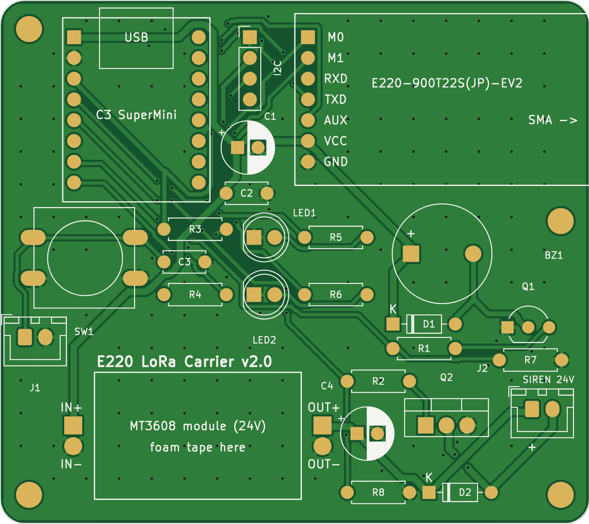
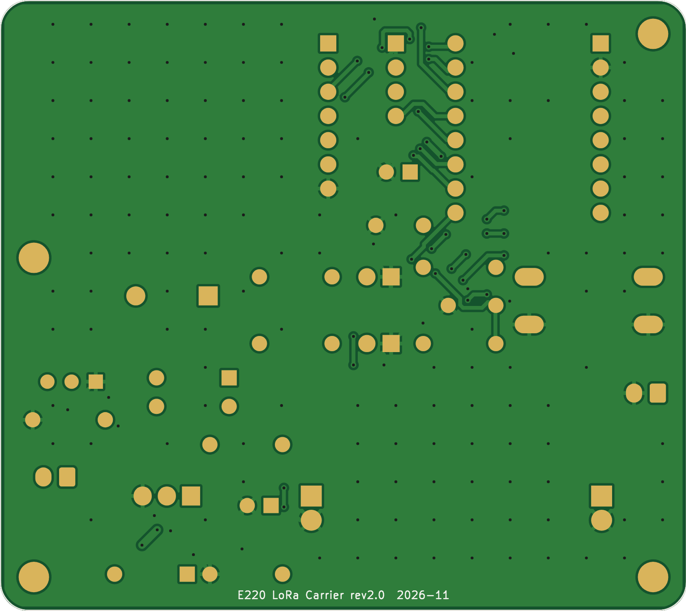

# E220 LoRa Carrier v2（差し込み式・全部手はんだ）

**ESP32-C3 SuperMini** と **E220-900T22S(JP)-EV2（SMA付き評価ボード）** をピンソケットで差し込むキャリア基板です。
部品はすべてスルーホール品なので、はんだごてだけで組み立てられます。マイコンやLoRaが壊れても差し替えるだけで直せます。
JLCPCBには基板の製造だけを発注し、部品は自分で揃えます。

| 表面 | 裏面 |
|---|---|
|  |  |

- 回路図: [`docs/schematic.pdf`](docs/schematic.pdf)（PNG: [`docs/schematic.png`](docs/schematic.png)）
- 実装図: [`docs/assembly_top.pdf`](docs/assembly_top.pdf)　DRC: [`docs/drc_report.txt`](docs/drc_report.txt)
- 製造データ: `production/e220_carrier_gerber_jlcpcb.zip`　部品リスト: `production/parts_list.csv`

## 仕様
| 項目 | 内容 |
|---|---|
| 基板 | 72 × 64 mm、2層、1.6mm、M3穴×4、部品は全部スルーホール |
| マイコン | ESP32-C3 SuperMini（1x8ピンソケット×2に差し込み、ピン列の間隔15.24mm、USB-Cは基板上端） |
| LoRa | E220-900T22S(JP)-EV2（1x7ピンソケットに差し込み、SMAは基板右端からはみ出す向き） |
| 電源 | モバイルバッテリー → SuperMiniのUSB-C → 5V端子から各部へ（充電回路なし） |
| ボタン | 12mmタクトSW＋外付けボタン用XH 2P（並列接続） |
| 基板ブザー | 5V自励式電子ブザー 12mm（85dB）、2SC1815で駆動 |
| サイレン | MT3608昇圧モジュールで**24V**に昇圧 → TIP120で外付けピエゾサイレンをON/OFF（XH 2P） |
| LED | 5mm 緑・赤 |
| 拡張 | I2C用ピンヘッダ 1x4（GND, 3V3, SCL=IO9, SDA=IO8。0.96インチOLEDと同じ並び） |

## ピン割り当て（SuperMini）
| GPIO | 信号 | 接続先 |
|---|---|---|
| IO0 | BTN_IO | ボタン（10kでプルアップ、1kを直列） |
| IO1 | BUZ | 基板ブザー（Highで鳴る） |
| IO2 | — | 未使用（起動時に状態を見るピンなので空けています） |
| IO3 | SIREN | 24Vサイレン（Highで鳴る。起動中は100kのプルダウンでOFF） |
| IO4 | LED_G | 緑LED |
| IO5 | LORA_RXD | ESP32 TX → E220 RXD（UART1） |
| IO6 | LORA_TXD | E220 TXD → ESP32 RX（UART1） |
| IO7 | LORA_AUX | E220 AUX |
| IO8 | I2C_SDA | J3（SuperMini上の青LEDと共用） |
| IO9 | I2C_SCL | J3（SuperMini上のBOOTボタンと共用） |
| IO10 | LORA_M0 | E220 M0 |
| IO20 | LORA_M1 | E220 M1 |
| IO21 | LED_R | 赤LED（起動時のログ出力で一瞬点滅するが無害） |

E220-EV2: VCCは5Vから給電します（VCCの範囲は3.1〜5.5V。信号は3.3Vのまま）。
M0/M1はE220内部でプルアップされているため、電源を入れた直後は設定モード（1/1）です。ファームウェアで0/0にして通常モードにします。

## 部品リスト（1台分）と価格の目安
| 記号 | 部品 | 個数 | 目安 |
|---|---|---|---|
| A1 | ESP32-C3 SuperMini（ピンヘッダ付き）＋ 1x8ピンソケット×2 | 1 | 400〜600円 |
| A2 | E220-900T22S(JP)-EV2 ＋ 1x7ピンソケット | 1 | 1,980円 |
| A3 | MT3608 昇圧モジュール（形はどれでも可） | 1 | 100〜160円 |
| BZ1 | 電子ブザー 5V 自励式 12mm（足の間隔7.6mm） | 1 | 50〜100円 |
| Q1 | 2SC1815（GR）または同等品 ※足の並びがE-C-Bのもの | 1 | 10〜20円 |
| Q2 | TIP120（TO-220） | 1 | 50〜100円 |
| D1, D2 | 1N4148 | 2 | 数円 |
| R1, R2, R4 / R3 / R5, R6 / R7, R8 | 1/4Wカーボン抵抗 1kΩ / 10kΩ / 220Ω / 100kΩ | 8 | 数十円 |
| C1 / C4 | 電解コンデンサ 100µF 16V以上 / 47µF 35V以上 | 2 | 数十円 |
| C2, C3 | 積層セラミック 0.1µF（足の間隔5mm） | 2 | 数十円 |
| SW1 | タクトスイッチ 12mm | 1 | 20〜50円 |
| LED1, LED2 | LED 5mm 緑・赤 | 2 | 数十円 |
| J1, J2 | JST XH 2P ポスト（＋ハウジング） | 2 | 数十円 |
| J3 | ピンヘッダ 1x4（任意） | 1 | 数円 |
| 基板 | JLCPCB 10枚＋送料（1枚あたり） | 1 | 約250円 |

**10台分の目安:** E220-EV2を除くと約1.0〜1.3万円、E220-EV2（1,980円×10）を含めると約3万円です。
アンテナ、外付けサイレン、モバイルバッテリーは別に必要です。

## 組み立て手順
1. 背の低い部品から付けます：抵抗、ダイオード（帯がある側＝K）、セラミックコンデンサ、トランジスタ、LED（足の長い方＝＋＝四角パッドの反対側）、タクトSW、ブザー（＋＝四角パッド）、電解コンデンサ（＋を合わせる）、XHコネクタ、ピンソケット。
2. **MT3608モジュールは配線する前に、テスターを見ながら半固定抵抗を回して24Vに合わせます**（USB 5Vを入力して測定）。合わせたら半固定抵抗を接着剤などで固定します。
3. モジュールを両面テープで基板の枠内に貼り、IN+/IN−/OUT+/OUT−を短い線でパッドにつなぎます。
4. SuperMiniとE220-EV2を差し込みます（向きはシルクの「USB」と「M0〜GND」に合わせる）。EV2はSMA側が浮くので、スペーサーや両面テープで支えると安定します。
5. J2にサイレンをつなぎます（＋はシルクの「+」側＝1番ピン）。**必ずDC24V対応のサイレンを使ってください。**

## 注意点
- 電源はSuperMiniのUSB-Cからのみ供給します。サイレンが鳴っている間は5V側に0.3〜0.5A程度流れます（モバイルバッテリーなら十分）。
- Q1を2SC1815以外で代用する場合は、足の並びを確認してください（S8050などは並びが違います）。
- SuperMiniの外部給電用5V端子とUSBは同時に使えません。この基板はUSBから給電する前提で、5V端子はSuperMiniから外部への出力として使っています。
- 110dB級のサイレンを近くで鳴らすと耳を傷めます。
- 配線は信号0.4mm / 電源0.6〜0.8mm、クリアランス0.2mm以上。KiCadのDRCでクリアランス違反・未接続ともに0件です（残りはライブラリ表の設定警告と、シルクが基板端やパッドで切れる警告のみ）。

## JLCPCBへの発注
`production/e220_carrier_gerber_jlcpcb.zip` をアップロードし、2層 / 1.6mm / 数量10で注文します。PCB Assemblyは不要です。

## データの再生成
```bash
cd hardware/e220-lora-carrier/gen && ./build.sh
```
`gen/design.py`（回路）と `gen/placement.py`（配置）を元に、回路図・基板・製造データをすべて作り直します。
