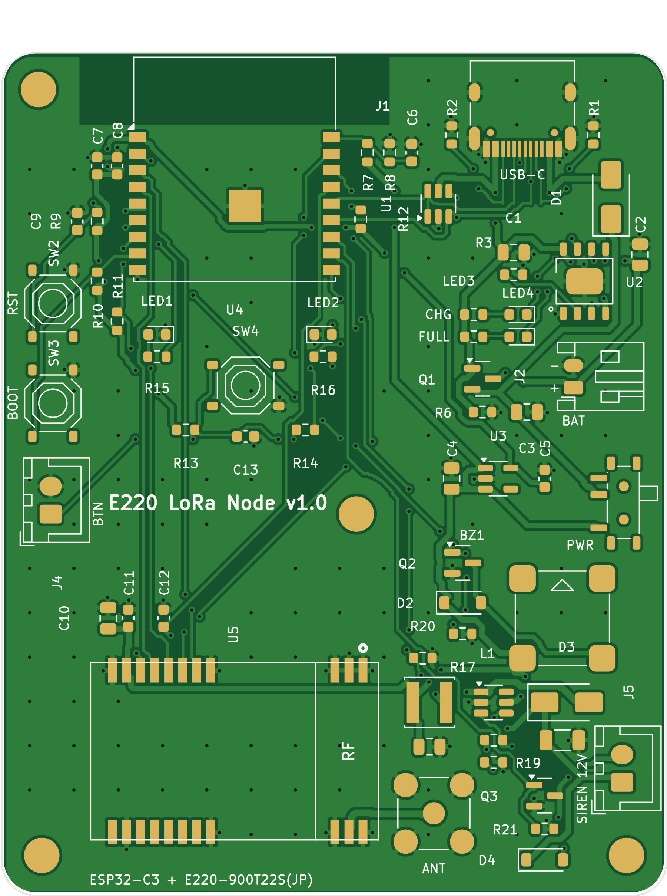
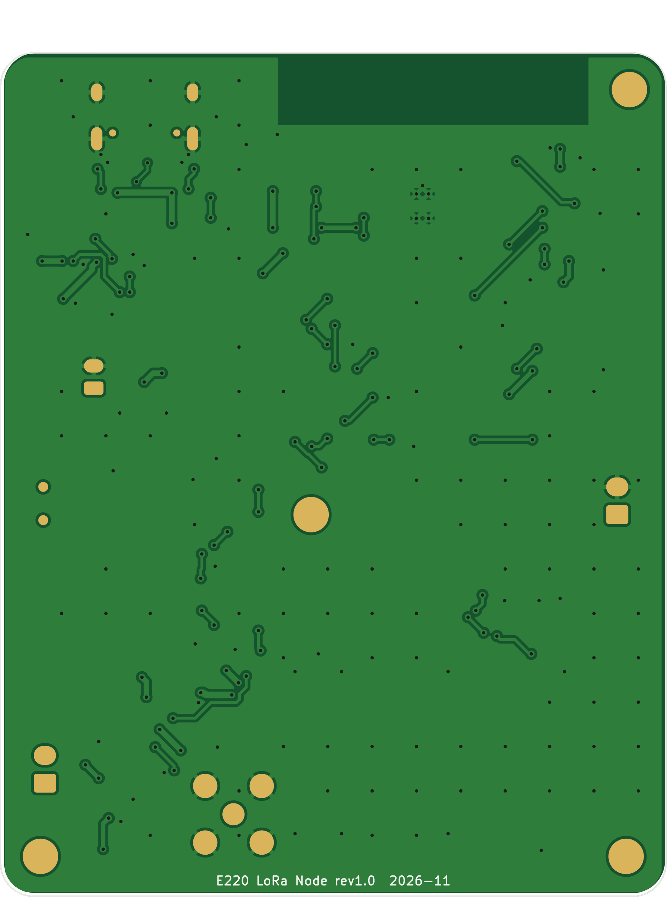

# E220 LoRa Node（E220-900T22S(JP) + ESP32-C3）

920MHz LoRa モジュール **E220-900T22S(JP)** と **ESP32-C3** を載せた、ボタン・大音量ブザー・LED 付きの
LoRa 通信基板です。JLCPCB で基板製造と部品実装（PCBA）を発注できるよう、全部品を
**LCSC 在庫品（2026-11-13 時点で全品番在庫ありを確認済み）** から選定しています。

| 表面 | 裏面 |
|---|---|
|  |  |

- 回路図: [`docs/schematic.pdf`](docs/schematic.pdf)（PNG: [`docs/schematic.png`](docs/schematic.png)）
- 実装図（部品番号入り）: [`docs/assembly_top.pdf`](docs/assembly_top.pdf)
- DRC結果: [`docs/drc_report.txt`](docs/drc_report.txt)
- KiCad 7 プロジェクト: `e220_lora.kicad_pro` / `.kicad_sch` / `.kicad_pcb`（KiCad 7 以降で開けます）

## 仕様

| 項目 | 内容 |
|---|---|
| 基板 | 60 × 76 mm、2層、1.6mm、M3穴×4、部品はすべて表面（片面実装） |
| MCU | ESP32-C3-WROOM-02-N4（Wi-Fi/BLE、USB直結で書き込み可・USBシリアル変換IC不要） |
| LoRa | E220-900T22S(JP)、UART接続（M0/M1/AUX もGPIO接続）、アンテナは SMA（基板上）またはモジュールのIPEX |
| ボタン | 基板上タクトSW（SW4）＋外付けボタン用 JST-XH 2P（J4、並列接続。アーケードボタン等を配線可） |
| ブザー | ①基板上 MLT-8530 電磁ブザー（80dB、PWMで音程・パターン可変）<br>②**12V昇圧出力（J5）で外付けピエゾサイレン（100dB級）を駆動** ← 最大音量用 |
| LED | 緑・赤（GPIO制御）、充電中（赤）・満充電（緑） |
| 電源 | USB-C 5V、または 1S LiPo（JST-PH 2P）。基板上で充電（TP4056、約580mA）、電源スライドSW、3.3V LDO |
| 電池電圧監視 | VSW/2 を ADC（IO0）で測定 |

### 「可能な限り大音量」について
基板に載る（JLCPCBで実装できる）ブザーは 85dB 級が上限なので、2段構えにしています。

1. **基板上 MLT-8530（80dB @10cm）**: 2.7kHz 付近のPWMで最も大きく鳴ります。確認音・操作音向け。
2. **J5: 12.6V 出力（MT3608 昇圧 + AO3400 ローサイドSW）**: 市販の「12V 圧電サイレン / 電子ブザー（95〜110dB）」を
   XHコネクタで接続します。フィールドで本当に聞こえる音が必要な場合はこちら。
   - 鳴らし方: `SIREN_EN(IO10)=H` で昇圧ON → `SIREN_PWM(IO20)=H`（またはPWMで断続音）。待機中は両方Lにすると昇圧が止まり電池を消費しません。
   - 12Vサイレンは概ね 20〜60mA。LiPo側では 0.3〜0.5A 程度流れるので、500mAh以上の電池を推奨。

## ESP32-C3 ピン割り当て

| GPIO | 信号 | 接続先 / 備考 |
|---|---|---|
| IO0 | BAT_ADC | 電池電圧(VSW)の1/2（ADC1_CH0） |
| IO1 | BTN_IO | メインボタン（SW4 / J4、10kプルアップ、ディープスリープ復帰可） |
| IO2 | LORA_M1 | E220 M1（ストラップピンのため10kプルアップ） |
| IO3 | LORA_AUX | E220 AUX（100nF、復帰トリガ可） |
| IO4 | LORA_M0 | E220 M0 |
| IO5 | LORA_TXD | E220 TXD → ESP32 RX（UART1） |
| IO6 | LED_G | 緑LED |
| IO7 | BUZ | 基板上ブザー（AO3400経由、PWM） |
| IO8 | LORA_RXD | ESP32 TX（UART1）→ E220 RXD（ストラップピン、10kプルアップ） |
| IO9 | BOOT | BOOTボタン |
| IO10 | SIREN_EN | 12V昇圧 ON/OFF（100kプルダウン） |
| IO18/19 | USB D-/D+ | USB-C（書き込み・シリアル） |
| IO20 | SIREN_PWM | 外付けサイレンのSW（100kプルダウン。起動時は入力なので誤鳴動しない） |
| IO21 | LED_R | 赤LED（起動ログで一瞬点滅するが無害） |

E220 のモード: M1/M0 = 0/0 通常、0/1 WOR送信、1/0 WOR受信、1/1 設定/スリープ（データシート Rev2.1.2）。

## JLCPCB への発注手順

`production/` のファイルを使います。

1. **PCB**: JLCPCB の PCB 注文画面に `production/e220_lora_gerber_jlcpcb.zip` をアップロード
   （2層 / 1.6mm / 他はデフォルトでOK）。
2. **PCB Assembly** をON（Top Side）。
3. BOM に `production/e220_lora_bom_jlcpcb.csv`、CPL に `production/e220_lora_cpl_jlcpcb.csv` を指定。
4. 部品確認画面で **部品の向き（回転）をプレビューで必ず確認** してください。
   SOT-23系は補正済みですが、JLCPCB側のフットプリント原点・向きとの差は最終的に画面上で確認するのが確実です。
5. E220-900T22S(JP) は **LCSC取扱いがないためBOMに含めていません（U5は未実装で届きます）**。
   手はんだ（端面スルーホールなので手はんだ可）か、JLCPCB のグローバルソーシング / 委託部品で供給してください。

### 部品について
- 基本部品（Basic）20品番、拡張部品（Extended）12品番。拡張部品は1品番ごとにJLCPCBの段取り費が掛かります。
- スルーホール部品（J2 電池コネクタ、J4/J5 XH、J3 SMA）もBOMに入っています。手はんだにする場合は
  BOM/CPLの該当行を削除してから発注してください。
- J3（SMA）は任意です。E220モジュール上のIPEXにピグテールでアンテナを付けるなら不要。**ANT端子とIPEXの同時使用はしないこと。**

| Ref | 部品 | LCSC | 区分 |
|---|---|---|---|
| U4 | ESP32-C3-WROOM-02-N4 | C2934560 | Extended |
| U5 | E220-900T22S(JP) | — | 手配・手はんだ |
| U2 | TP4056 (ESOP-8) | C16581 | Extended |
| U3 | AP2112K-3.3 | C51118 | Extended |
| U6 | MT3608 | C84817 | Extended |
| U1 | USBLC6-2SC6 | C7519 | Extended |
| Q1 | AO3401A | C15127 | Basic |
| Q2,Q3 | AO3400A | C20917 | Basic |
| D1,D3 | SS34 | C8678 | Basic |
| D2,D4 | 1N4148W | C81598 | Basic |
| L1 | SWPA4030S100MT 10uH | C38117 | Extended |
| BZ1 | MLT-8530 | C94599 | Extended |
| J1 | USB-C TYPE-C-31-M-12 | C165948 | Extended |
| J2 | JST S2B-PH-K-S | C173752 | Extended |
| J3 | SMA BWSMA-KE-Z001 | C496549 | Extended |
| J4,J5 | JST B2B-XH-A | C158012 | Extended |
| SW1 | MSK12C02 スライドSW | C431541 | Extended |
| SW2-4 | TS-1187A タクトSW | C318884 | Basic |
| LED1,4 / LED2,3 | KT-0603G / KT-0603R | C12624 / C2286 | Extended / Basic |
| R, C | 0603/0805/1206 チップ部品 | BOM参照 | Basic |

## 設計メモ・注意点
- **E220 給電**: VCC（10番）に VSW（電池 3.0〜4.2V / USB時 約4.7V）を供給。VDD（15番）は未接続（内部LDO出力）。
  データシート推奨どおり AUX-GND 間に100nF。RF側（1〜3, 20〜22番）は GND ベタに接続。
- **ESP32 アンテナ**: 基板上端に配置し、アンテナ下は表裏とも銅箔なし（キープアウト）。
- **電池コネクタ極性**: J2 は pin1 = +（シルクの +/-）。JST-PH付きLiPoは製品により極性が逆のものがあるので必ず確認。保護回路付きLiPoを使用してください。
- 充電電流は R3=2kΩ で約580mA。小容量電池なら R3 を大きく（例: 3.3kΩ≒350mA）。
- 電源SW（SW1）はシステム側のみ切ります。OFFでもUSBを挿せば充電されます。
- 配線: 信号0.25mm / 電源0.4〜0.6mm、クリアランス0.15mm以上、ビア0.6/0.3mm（JLCPCB標準仕様内）。
  KiCad の DRC でクリアランス違反・未接続ともに0件（残りはライブラリ表の設定警告と、E220端面パッドにかかる外形シルクの警告のみ）。

## データの再生成
回路・部品・配置はすべてスクリプトから生成しています（KiCad 7 + Python/numpy）。

```bash
cd hardware/e220-lora-node/gen && ./build.sh
```

- `gen/design.py` … 部品・LCSC番号・ネット（回路の元データ）
- `gen/placement.py` … 基板上の部品配置
- `gen/footprints.py` … E220（データシートの推奨フットプリントから作図）と、LCSC部品のフットプリント（EasyEDA公開データから変換）
- `gen/router.py` … 自動配線（2層グリッドA*）。USB-C部は手引きパターン
- `gen/make_production.py` … JLCPCB用ガーバー/BOM/CPL

KiCad で手直しする場合は、`.kicad_pcb` を直接編集してかまいません（再生成すると上書きされる点に注意）。

## 参考
- E220-900T22S(JP) データシート Rev2.1.2（CLEALINK）: ピン配置（3.1章）、推奨フットプリント（図51）
- ESP32-C3-WROOM-02 データシート（Espressif）
